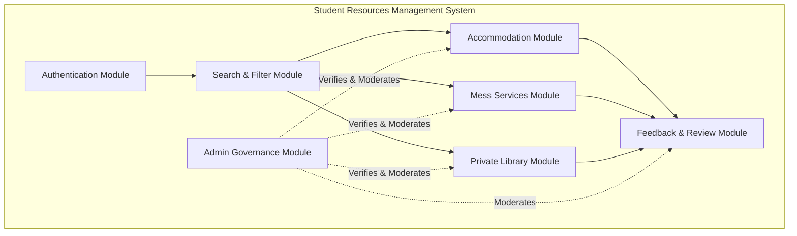
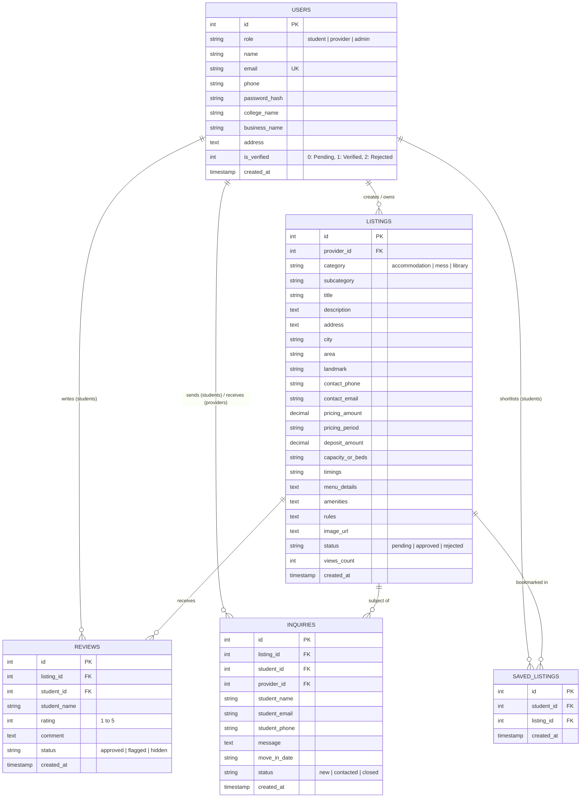
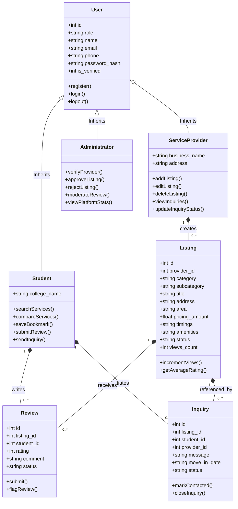
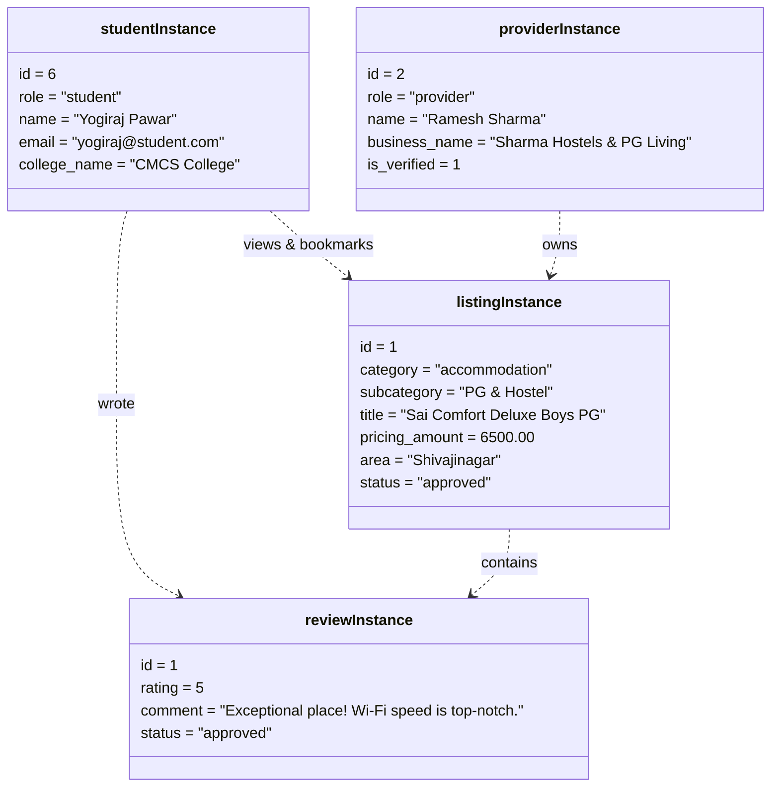
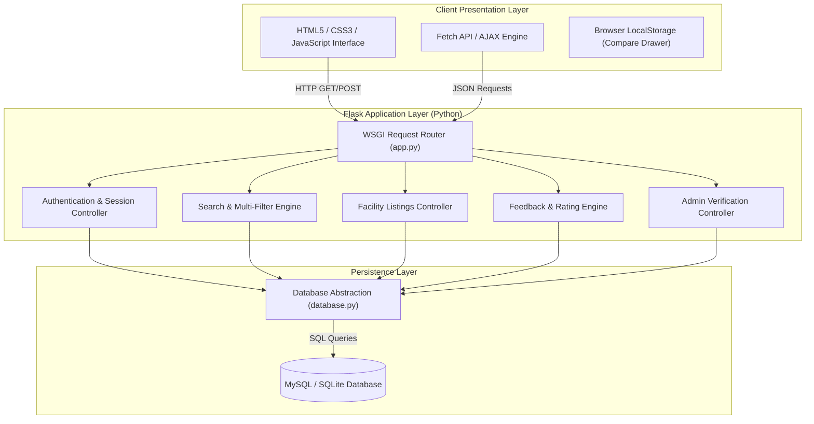
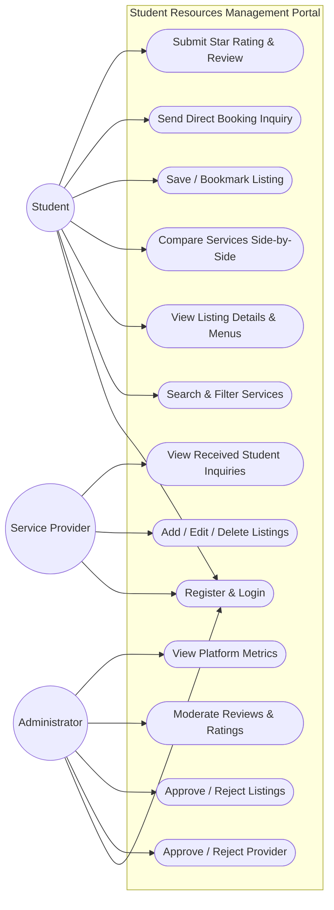
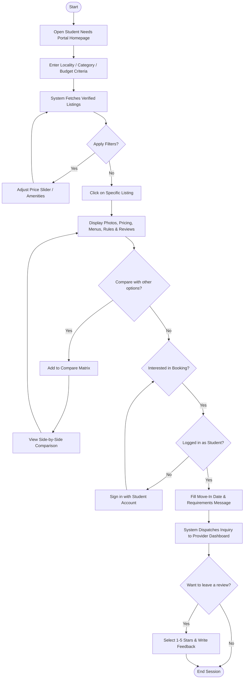
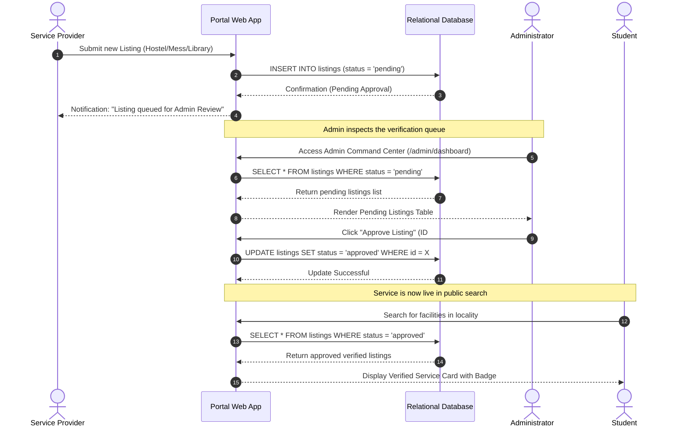

# SAVITRIBAI PHULE PUNE UNIVERSITY
## COMMERCE MANAGEMENT AND COMPUTER SCIENCE COLLEGE
### T.Y.B.Sc. (Computer Science) | NEP CBCS 2026–2027

---

# PROJECT REPORT
ON
## **STUDENT RESOURCES MANAGEMENT SYSTEM**
*(Student Needs Portal)*

**Submitted by:**
1. **Yogiraj Pawar** (Roll No: ______, Seat No: ______)
2. **Onkar Shinde** (Roll No: ______, Seat No: ______)

**Under the Guidance of:**
Internal Guide: Prof. _____________________
Head of Department: _____________________

**Academic Year:** 2026–2027

---

## **INDEX**

| Sr. No. | Section Title | Page No. | Signature of Instructor |
|:---:|:---|:---:|:---:|
| **1** | **Preliminary Investigation** | 4 | |
| | 1.1 Problem Identification | 4 | |
| | 1.2 Problem Statement / Definition | 5 | |
| | 1.3 Purpose / Objective and Goals | 6 | |
| | 1.4 Feasibility Study (Technical, Operational, Economic, Schedule) | 7 | |
| | 1.5 Project Scope and Limitations | 9 | |
| **2** | **Requirement Specification** | 10 | |
| | 2.1 System Requirement (Hardware & Software Specifications) | 10 | |
| | 2.2 Technical Requirement (Programming Languages, Frameworks, Tools) | 11 | |
| | 2.3 Functional Requirements | 12 | |
| | 2.4 Data Requirements, Performance & Security Requirements | 14 | |
| **3** | **Database Design** | 16 | |
| | 3.1 Identify End Users of the System | 16 | |
| | 3.2 Entities and Attributes (Entity-Relationship ER Diagram) | 17 | |
| | 3.3 Relational Tables, Data Types, Constraints & Relationships | 19 | |
| **4** | **System Design (UML Modeling)** | 22 | |
| | 4.1 Class Diagram | 22 | |
| | 4.2 Object Diagram | 24 | |
| | 4.3 Component Diagram | 25 | |
| | 4.4 Deployment Diagram | 27 | |
| | 4.5 Use Case Diagram | 28 | |
| | 4.6 Activity Diagram | 30 | |
| | 4.7 Sequence Diagram | 32 | |
| **5** | **Input and Output Screen Layout** | 34 | |
| **6** | **Bibliography / References** | 39 | |

---

## 1. PRELIMINARY INVESTIGATION

### 1.1 Problem Identification
Every academic semester, tens of thousands of students relocate from rural and suburban regions to higher education hubs across Maharashtra (such as Pune, Nashik, and Mumbai) to pursue undergraduate and postgraduate degrees. Upon arriving in a new city, students face immediate, high-stakes logistical challenges:
1. **Finding Safe Accommodation:** Discovering verified hostels, paying guest (PG) accommodations, and student-friendly rental rooms near their respective campuses.
2. **Accessing Daily Meal Facilities (Mess):** Locating hygienic, nutritional, and affordable food mess services that cater to vegetarian, Maharashtrian, and regional meal preferences.
3. **Locating Quiet Study Environments:** Finding dedicated private libraries and reading rooms with uninterrupted Wi-Fi, air conditioning, and power sockets for intensive competitive and semester exam preparations.

Currently, students depend on informal WhatsApp groups, social media community pages, brokers charging exorbitant brokerage fees, and physically walking across streets looking for signboards. This ad-hoc approach leads to financial exploitation, security risks, misleading facility claims, and immense mental exhaustion during the critical first weeks of college admission.

### 1.2 Problem Statement / Definition
> *"To design and develop a centralized, secure, and user-friendly web application—**Student Resources Management System (Student Needs Portal)**—that connects college students with admin-verified accommodation providers, mess operators, and private libraries, enabling multi-attribute search, transparent fee comparisons, direct communication with zero brokerage, and genuine student review moderation."*

The core problem stems from:
- **Lack of Verified Information:** Misleading photographs and false amenity promises by unregistered landlords.
- **Time-Consuming Manual Search:** Absence of a single consolidated portal covering accommodation, food, and libraries.
- **Difficulty in Comparing Available Options:** Students cannot easily evaluate prices, security deposits, gate curfew timings, and facilities side-by-side.
- **Limited Access to Reviews:** Inability to read candid feedback from peers who previously stayed at or dined in these facilities.

### 1.3 Purpose / Objective and Goals

#### Objectives:
1. **Centralized Student Service Hub:** Build a unified portal for three indispensable student needs: Hostels/PGs, Food Messes, and Study Libraries.
2. **Admin-Supervised Verification:** Enforce an approval process where landlords and facility listings are audited by the administrator before being publicly visible.
3. **Dynamic Multi-Faceted Filtering:** Enable students to search by locality/area, campus proximity, maximum monthly budget, food preferences, and amenities (Wi-Fi, AC, Hot Water).
4. **Side-by-Side Comparison Engine:** Provide a multi-column comparison matrix contrasting up to 4 facilities across rental costs, security deposits, timings, and rules.
5. **Authentic Student Feedback:** Facilitate a verified 1-to-5 star rating and review ecosystem with administrative spam moderation.
6. **Direct Zero-Brokerage Interaction:** Enable students to send direct booking inquiries to property owners without third-party commission.

#### Goals:
- Reduce accommodation search turnaround from weeks to a few minutes.
- Eliminate middleman brokerage fees for college students.
- Promote hygienic and verified student living standards.

### 1.4 Feasibility Study

#### A. Technical Feasibility
The system is built using modern, highly stable, and open-source software technologies:
- **Backend:** Python (Flask framework), providing lightweight execution, minimal overhead, and modular routing.
- **Frontend:** HTML5, CSS3 (Modern Responsive Flexbox/Grid Design System), and JavaScript (ES6, Fetch API) guaranteeing cross-device compatibility across desktop and mobile screens.
- **Database:** Dual-engine architecture supporting SQLite for local prototyping and MySQL for relational scalability with foreign-key constraints.
- *Conclusion:* **Technically Feasible** as it requires standard web stacks easily deployable on university or cloud environments.

#### B. Operational Feasibility
- The system features intuitive, human-centered UI cards, straightforward filter sliders, and 1-click demo logins.
- Students do not need any special training—the interface mimics popular e-commerce and booking platforms.
- Facility providers can list properties using simplified, category-adaptive forms.
- *Conclusion:* **Operationally Feasible** with strong user acceptance.

#### C. Economic Feasibility
- Developed completely using open-source tools: Python, Flask, VS Code, Git, and MySQL/SQLite.
- Zero licensing or proprietary software fees.
- Hosting can be accomplished on free or low-cost cloud tiers (e.g., Render, PythonAnywhere, or college campus intranet).
- *Conclusion:* **Economically Feasible** with zero initial capital investment.

#### D. Schedule Feasibility
The project development was divided into structured sprints:
1. Requirement Analysis & Synopsis Approval: Week 1–2
2. Database Schema & Architecture Design: Week 3–4
3. Backend Routing & Authentication: Week 5–6
4. Frontend UI/UX, CSS Design System & JS: Week 7–8
5. Admin Verification & Review Moderation: Week 9–10
6. Testing, Tuning & Documentation: Week 11–12
- *Conclusion:* **Schedule Feasible** and completed within the academic calendar.

### 1.5 Project Scope and Limitations

#### Scope:
- **Three Specialized User Roles:** Student, Service Provider, and Administrator.
- **Service Categories:** Accommodations (Hostel, PG, Room), Mess/Bhojanalaya, and Private Libraries.
- **Inquiry Management:** Direct inquiry dispatch from students to providers.
- **Review System:** Star ratings, breakdown distribution bars, and text feedback.
- **Cross-Service Comparison Matrix:** Side-by-side facility analysis.

#### Limitations:
- Real-time online monetary payment gateway integration is left as a future scope (currently handles booking inquiries and cash/UPI offline payments).
- GPS live navigation is limited to street addresses and landmarks rather than an integrated map API.
- Offline functionality is limited to cached responses.

---

## 2. REQUIREMENT SPECIFICATION

### 2.1 System Requirement (Hardware & Software Specifications)

#### Hardware Specifications (Minimum):
- **Processor:** Intel Core i3 (2.0 GHz) or AMD Ryzen 3 equivalent or higher
- **RAM:** 4 GB RAM minimum (8 GB recommended)
- **Hard Disk / SSD Space:** 500 MB free disk space for application files and SQLite/MySQL database
- **Display Resolution:** 1366 x 768 minimum (Fully responsive for mobile 360 x 640 screens)
- **Network Interface:** Active LAN / Wi-Fi connection for network deployment

#### Software Specifications:
- **Operating System:** Windows 10 / 11, Linux (Ubuntu 20.04+), or macOS
- **Runtime Environment:** Python 3.10 to Python 3.13
- **Web Browser:** Modern browser (Google Chrome 110+, Mozilla Firefox 110+, Microsoft Edge, Safari)
- **Database Server:** MySQL 8.0+ / MariaDB or SQLite 3.45+ (built-in)

### 2.2 Technical Requirement
- **Backend Framework:** Python Flask 3.1.x (WSGI compliant, Jinja2 templating, Werkzeug security engine)
- **Database Connector:** `mysql-connector-python 9.x` / `sqlite3`
- **Frontend Stack:** HTML5 Semantic Markup, Custom CSS3 Variables, JavaScript ES6
- **Development & Version Control Tools:** Visual Studio Code (VS Code), Git, GitHub Desktop, OpenSSH

### 2.3 Functional Requirements



1. **FR-1: User Registration & Authentication**
   - Students can register with Name, Email, Phone, College Name, and Password.
   - Service Providers register with Business Name, Owner Name, Contact Phone, and Address.
   - Passwords must be hashed using PBKDF2/SHA-256 before database insertion.
   - Role-based route protection via Python decorators (`@login_required`, `@role_required`).

2. **FR-2: Accommodation Listing Management**
   - Providers can create listings specifying occupancy (Single, 2-Sharing, 3-Sharing), monthly rent, refundable deposit, gate curfew timings, solar water, Wi-Fi, and house rules.

3. **FR-3: Mess Services Listing Management**
   - Providers can detail daily thali menus (chapatis, sabzis, dal, rice, sweet), meal timings (lunch/dinner), monthly subscription plans, and tiffin delivery.

4. **FR-4: Private Library Listing Management**
   - Providers can specify operating hours (e.g. 24/7 or 6:00 AM - 11:30 PM), desk capacity, AC silent zone status, individual power sockets, and daily/monthly pass fees.

5. **FR-5: Multi-Criteria Search & Filtering**
   - Search across title, locality, and description.
   - Filter by Category, Sub-type, City, Locality/Area, Max Budget limit, and Amenities.
   - Sort by Popularity (Views count), Highest Rated, Price (Low to High), and Newest.

6. **FR-6: Side-by-Side Comparison Matrix**
   - Students can select up to 4 services and view a comparison table detailing price, deposit, timings, capacity, rating, amenities, and house rules.

7. **FR-7: Student Ratings & Reviews**
   - Only authenticated students can rate a service (1 to 5 stars) and submit written feedback.
   - Automatic recalculation of average ratings and star breakdown distributions.

8. **FR-8: Administrator Control & Verification**
   - Administrator dashboard displaying real-time metrics.
   - Dedicated review queue to approve or reject pending provider accounts and listings.
   - Audit and moderation tools to flag or remove offensive student reviews.

### 2.4 Data Requirements, Performance & Security Requirements

#### Data Integrity Requirements:
- Unique constraints on user email addresses.
- Foreign key constraints with cascading deletes (`ON DELETE CASCADE`) to prevent orphaned records when a listing or user is deleted.
- Sanitized strings to prevent SQL truncation.

#### Performance Requirements:
- **Response Time:** Page loads under 250ms for indexed local queries.
- **Concurrent Users:** Flask WSGI / Gunicorn multi-worker handling up to 100 concurrent requests on entry-level hardware.
- **Database Indexing:** Indexed lookups on `listings.status`, `listings.category`, and `listings.area`.

#### Security Requirements:
- **Cryptographic Hashing:** Passwords stored using PBKDF2-HMAC-SHA256 with salt.
- **Parameterized SQL Queries:** All database interactions use SQL parameter substitution (`?` / `%s`) preventing SQL Injection (SQLi).
- **Cross-Site Scripting (XSS) Prevention:** Jinja2 auto-escaping on all dynamic user inputs.
- **Session Security:** Cryptographically signed session cookies with `SECRET_KEY`.

---

## 3. DATABASE DESIGN

### 3.1 Identify End Users of the System
1. **Student:** Searches facilities, compares options, saves bookmarks, sends booking inquiries, and posts ratings and reviews.
2. **Service Provider (Hostel / Mess / Library Owner):** Manages facility profiles, creates listings, monitors view counts, and tracks student inquiries.
3. **Administrator:** System auditor who verifies providers, approves/rejects listings, moderates feedback, and monitors overall platform integrity.

---

### 3.2 Entities and Attributes (Entity-Relationship ER Diagram)



---

### 3.3 Relational Tables, Data Types, Constraints & Relationships

#### Table 1: `users`
| Column Name | Data Type | Constraints | Description |
|:---|:---|:---|:---|
| `id` | INT / INTEGER | PK, AUTO_INCREMENT | Unique user identifier |
| `role` | VARCHAR(20) | NOT NULL, DEFAULT 'student' | Role: 'student', 'provider', 'admin' |
| `name` | VARCHAR(120) | NOT NULL | User's full name / owner name |
| `email` | VARCHAR(150) | NOT NULL, UNIQUE | User email address for login |
| `phone` | VARCHAR(30) | NULL | Contact mobile number |
| `password_hash` | VARCHAR(255) | NOT NULL | Salted PBKDF2 password hash |
| `college_name` | VARCHAR(150) | NULL | College affiliation (for students) |
| `business_name` | VARCHAR(150) | NULL | Enterprise/mess name (for providers) |
| `address` | TEXT | NULL | Physical address |
| `is_verified` | TINYINT / INTEGER | DEFAULT 0 | 0: Pending, 1: Verified, 2: Rejected |
| `created_at` | TIMESTAMP | DEFAULT CURRENT_TIMESTAMP | Registration timestamp |

#### Table 2: `listings`
| Column Name | Data Type | Constraints | Description |
|:---|:---|:---|:---|
| `id` | INT / INTEGER | PK, AUTO_INCREMENT | Unique listing identifier |
| `provider_id` | INT / INTEGER | FK (users.id), NOT NULL | Owning service provider ID |
| `category` | VARCHAR(30) | NOT NULL | 'accommodation', 'mess', 'library' |
| `subcategory` | VARCHAR(60) | NOT NULL | E.g. 'Hostel', 'PG', 'Pure Veg Mess' |
| `title` | VARCHAR(200) | NOT NULL | Listing headline |
| `description` | TEXT | NULL | In-depth description |
| `address` | TEXT | NOT NULL | Street address |
| `city` | VARCHAR(100) | NOT NULL | City (e.g. Pune, Nashik) |
| `area` | VARCHAR(100) | NOT NULL | Locality / campus landmark |
| `landmark` | VARCHAR(150) | NULL | Prominent nearby spot |
| `contact_phone` | VARCHAR(30) | NOT NULL | Direct contact telephone |
| `contact_email` | VARCHAR(120) | NULL | Direct email contact |
| `pricing_amount` | DECIMAL(10,2) | NOT NULL | Monthly rent / subscription fee |
| `pricing_period` | VARCHAR(50) | DEFAULT 'Per Month' | Billing frequency |
| `deposit_amount` | DECIMAL(10,2) | DEFAULT 0.00 | Security deposit (refundable) |
| `capacity_or_beds`| VARCHAR(100) | NULL | E.g. '2 & 3 Sharing', '150 Cubicles' |
| `timings` | VARCHAR(150) | NULL | Gate curfew / operating hours |
| `menu_details` | TEXT | NULL | Daily food menu (for mess) |
| `amenities` | TEXT | NULL | Comma-separated amenity tags |
| `rules` | TEXT | NULL | Hostel / reading room regulations |
| `image_url` | TEXT | NULL | Banner photograph URI |
| `status` | VARCHAR(20) | DEFAULT 'pending' | 'pending', 'approved', 'rejected' |
| `views_count` | INT / INTEGER | DEFAULT 0 | Real-time views counter |
| `created_at` | TIMESTAMP | DEFAULT CURRENT_TIMESTAMP | Creation timestamp |

#### Table 3: `reviews`
| Column Name | Data Type | Constraints | Description |
|:---|:---|:---|:---|
| `id` | INT / INTEGER | PK, AUTO_INCREMENT | Unique review identifier |
| `listing_id` | INT / INTEGER | FK (listings.id), NOT NULL | Target facility ID |
| `student_id` | INT / INTEGER | FK (users.id), NOT NULL | Reviewing student ID |
| `student_name` | VARCHAR(100) | NOT NULL | Display name of reviewer |
| `rating` | INT / INTEGER | NOT NULL, CHECK (1..5) | 1 to 5 star rating |
| `comment` | TEXT | NOT NULL | Review body text |
| `status` | VARCHAR(20) | DEFAULT 'approved' | 'approved', 'flagged', 'hidden' |
| `created_at` | TIMESTAMP | DEFAULT CURRENT_TIMESTAMP | Submission timestamp |

#### Table 4: `inquiries`
| Column Name | Data Type | Constraints | Description |
|:---|:---|:---|:---|
| `id` | INT / INTEGER | PK, AUTO_INCREMENT | Unique inquiry identifier |
| `listing_id` | INT / INTEGER | FK (listings.id), NOT NULL | Target listing |
| `student_id` | INT / INTEGER | FK (users.id), NOT NULL | Inquiring student |
| `provider_id` | INT / INTEGER | FK (users.id), NOT NULL | Target provider |
| `student_name` | VARCHAR(100) | NOT NULL | Student full name |
| `student_email`| VARCHAR(120) | NOT NULL | Contact email |
| `student_phone`| VARCHAR(30) | NULL | Student mobile number |
| `message` | TEXT | NOT NULL | Student's requirements/query |
| `move_in_date` | VARCHAR(50) | NULL | Planned arrival date |
| `status` | VARCHAR(30) | DEFAULT 'new' | 'new', 'contacted', 'closed' |
| `created_at` | TIMESTAMP | DEFAULT CURRENT_TIMESTAMP | Dispatch timestamp |

#### Table 5: `saved_listings`
| Column Name | Data Type | Constraints | Description |
|:---|:---|:---|:---|
| `id` | INT / INTEGER | PK, AUTO_INCREMENT | Unique bookmark record ID |
| `student_id` | INT / INTEGER | FK (users.id), NOT NULL | Bookmarking student |
| `listing_id` | INT / INTEGER | FK (listings.id), NOT NULL | Saved listing ID |
| `created_at` | TIMESTAMP | DEFAULT CURRENT_TIMESTAMP | Bookmark timestamp |
| *(Unique Key)* | `(student_id, listing_id)` | UNIQUE | Prevents duplicate bookmarks |

---

## 4. SYSTEM DESIGN (UML MODELING)

### 4.1 Class Diagram



---

### 4.2 Object Diagram (Runtime Snapshot)



---

### 4.3 Component Diagram



---

### 4.4 Deployment Diagram

```mermaid
deployment
graph TB
    subgraph ClientDevice["Client Node (Mobile / PC / Tablet)"]
        Browser["Modern Web Browser (Chrome / Edge / Safari)"]
    end

    subgraph WebServerNode["Web / Application Server (Windows / Linux)"]
        WSGI["Python WSGI Server (Gunicorn / Flask)"]
        App["Student Resources Portal Application"]
        StaticAssets["Static Files (CSS, JS, Media)"]
    end

    subgraph DatabaseNode["Database Server Tier"]
        DBService["MySQL 8.0 Server / SQLite3 Engine"]
        DataFiles["Database Tables (student_portal_db)"]
    end

    Browser -- "HTTP / HTTPS (Port 80 / 443 / 5000)" --> WSGI
    WSGI --> App
    App --> StaticAssets
    App -- "TCP/IP Connection (Port 3306) / Local IPC" --> DBService
    DBService --> DataFiles
```

---

### 4.5 Use Case Diagram



---

### 4.6 Activity Diagram (Student Search & Inquiry Workflow)



---

### 4.7 Sequence Diagram (Admin Listing Verification Lifecycle)



---

## 5. INPUT AND OUTPUT SCREEN LAYOUT

### Screen 1: Homepage & Hero Discovery Section
- **Input:** Keyword search text box, category dropdown picker (Accommodation, Mess, Library), Max Budget numeric input (₹).
- **Output:** Featured verified hostels, top mess facilities, 24/7 private libraries, real-time platform statistics counter banner, and verified student feedback testimonials.

### Screen 2: Multi-Criteria Search & Filter Interface (`/search`)
- **Input:** 
  - Dynamic area dropdown (Shivajinagar, Kothrud, Viman Nagar, etc.)
  - Category selector radio/buttons
  - Maximum monthly rent range filter
  - Amenity checkboxes (High-speed Wi-Fi, AC, Food Included, CCTV, Individual Sockets)
  - Sort selector (Popular, Highest Rated, Price Low-to-High)
- **Output:** Dynamic grid of listing cards with sub-type badges, verified checkmarks, star rating aggregates, monthly fees, and compare checkboxes.

### Screen 3: Facility Detailed Specifications Page (`/listings/<id>`)
- **Input:** "Send Inquiry to Host" button, 1-to-5 star rating selector, review feedback comment box, "Save to Bookmarks" button.
- **Output:** High-definition banner photography, room sharing / mess menu details, operating timings & gate curfews, full amenities checklist, house rules, 5-bar rating distribution summary, and verified student reviews list.

### Screen 4: Side-by-Side Comparison Matrix (`/compare`)
- **Input:** Checkbox selection from search cards or dropdown adder.
- **Output:** Multi-column comparative table evaluating properties across 10 critical parameters: Facility Photo, Monthly Rent, Security Deposit, Campus Area, Star Rating, Capacity/Sharing, Gate Curfew/Timings, Amenities List, House Rules, and Provider Phone Number.

### Screen 5: Service Provider Hub (`/provider/dashboard`)
- **Input:** "+ List A New Student Service" form, listing edit form, inquiry status update toggle ("Mark as Contacted" / "Close").
- **Output:** Real-time metrics (Total Listings, Active & Approved, Pending Review, Total Student Views, Total Inquiries), listings management table, and student inquiries inbox.

### Screen 6: Administrator Control Console (`/admin/dashboard`)
- **Input:** "Approve" / "Reject" buttons on pending provider registrations, "Approve" / "Reject" / "Delete" buttons on facility listings, "Approve" / "Flag" buttons on student reviews.
- **Output:** Executive metric KPI cards (Total Users, Students, Verified Providers, Pending Approvals, Total Reviews, Inquiries), Provider Verification Queue, Listing Approval Queue, and Moderation Console.

---

## 6. BIBLIOGRAPHY / REFERENCES

### Textbooks & Academic Literature:
1. **Pressman, Roger S. & Maxim, Bruce R.** (2020). *Software Engineering: A Practitioner's Approach* (9th ed.). McGraw-Hill Education.
2. **Silberschatz, Abraham, Korth, Henry F., & Sudarshan, S.** (2020). *Database System Concepts* (7th ed.). McGraw-Hill.
3. **Grinberg, Miguel** (2018). *Flask Web Development: Developing Web Applications with Python* (2nd ed.). O'Reilly Media.
4. **Sommerville, Ian** (2016). *Software Engineering* (10th ed.). Pearson Education.

### Official Technical Documentation & Web Standards:
1. **Python Software Foundation:** Python 3.13 Language Reference & Standard Library Documentation — [https://docs.python.org/3/](https://docs.python.org/3/)
2. **Pallets Projects:** Flask Documentation (Version 3.1.x) — [https://flask.palletsprojects.com/](https://flask.palletsprojects.com/)
3. **World Wide Web Consortium (W3C):** HTML5 & CSS3 Web Standards Specifications — [https://www.w3.org/standards/](https://www.w3.org/standards/)
4. **Oracle Corporation:** MySQL 8.0 Reference Manual — [https://dev.mysql.com/doc/refman/8.0/en/](https://dev.mysql.com/doc/refman/8.0/en/)
5. **Mozilla Developer Network (MDN Web Docs):** JavaScript Reference & Fetch API Guidelines — [https://developer.mozilla.org/](https://developer.mozilla.org/)

---
*End of Documentation Report.*  
*Commerce Management and Computer Science College — Savitribai Phule Pune University (AY 2026–2027)*

